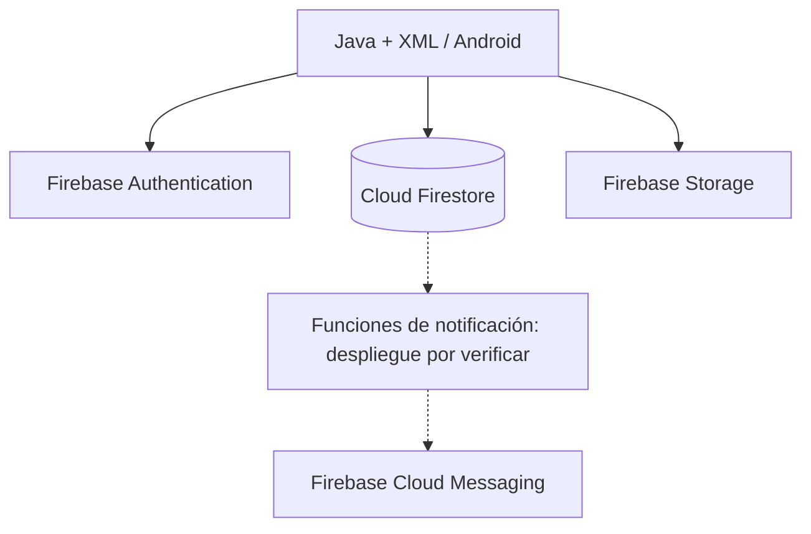

# AulaHub — Aplicación Android

**Cliente móvil para consultar la disponibilidad de espacios académicos, registrar solicitudes de reservación y revisar su estado.**

📱 **Android: este repositorio** · 🌐 **[Ver web publicada](https://aulahub-1f738.web.app/)** · 📖 **[README principal del sistema](https://github.com/lizq237/AULAHUB-web)**

> Proyecto académico en equipo de la Facultad de Informática Culiacán (UAS). El acceso a la app requiere un usuario previamente creado en Firebase Authentication y sus datos asociados en Firestore. **No existe cuenta de prueba pública confirmada.**

## Funcionalidades principales

- **Inicio de sesión** mediante correo y contraseña usando Firebase Authentication.
- **Selección de aulas y espacios académicos** desde la pantalla principal.
- **Reservación por fecha/horario, turno, materia y grupo**, según los datos disponibles para el docente en Firestore.
- **Mis reservas:** consulta de solicitudes y su estado.
- **Solicitudes pendientes:** revisión de solicitudes para administradores autorizados, con posibilidad de aceptación o rechazo.
- **Notificaciones:** vistas y lógica de notificación mediante Firestore, con dependencias y funciones de Firebase Cloud Messaging presentes en el proyecto. El despliegue real de funciones push no está verificado.

## Stack

| Área | Tecnologías |
| --- | --- |
| App | Android nativo, Java, XML |
| Entorno | Android Studio, Gradle (Kotlin DSL), Java 11 |
| Firebase | Authentication, Cloud Firestore, Storage y Messaging |
| SDK Android | compileSdk 36, targetSdk 36, minSdk 24 |
| Web relacionada | HTML5, CSS3 y JavaScript en Firebase Hosting |

La aplicación usa Firebase directamente; **no necesita un servidor Laravel, Node.js o API REST propia para el flujo descrito**.

## Ejecutar el proyecto en Android Studio

### 1. Clonar

```bash
git clone -b master https://github.com/lizq237/AULAHUBMOVIL.git
```

### 2. Abrir y compilar

1. Abre **Android Studio** y selecciona la carpeta `AULAHUBMOVIL`.
2. Permite que se sincronicen Gradle y las dependencias.
3. Configura un emulador compatible con el SDK mínimo (Android API 24+) o conecta un dispositivo de pruebas.
4. Pulsa **Run**.

El proyecto contiene un archivo `app/google-services.json` para la configuración del SDK del cliente. **Esto no contiene la contraseña de los usuarios ni te concede permisos administrativos de Firebase Console.** La configuración actual está vinculada al proyecto utilizado por AulaHub; no hagas pruebas destructivas contra datos reales.

### 3. Iniciar sesión

La pantalla de inicio utiliza **`FirebaseAuth.signInWithEmailAndPassword`**. No registra usuarios nuevos desde Android.

Para probar la app se necesita:

- Un usuario ficticio en **Firebase Authentication → Users**.
- Un documento asociado en Firestore, según su rol (colecciones `roles` o `profesores`).
- Materias/grupos de prueba cuando se quiera comprobar la reservación.
- Reglas Firestore desplegadas que permitan únicamente las operaciones autorizadas.

**No se incluyen contraseñas en el repositorio.** El README web explica cómo recuperar acceso al proyecto Firebase y por qué las reglas disponibles en GitHub requieren una revisión.

## Recorrido sugerido para evaluadores

**Con cuentas ficticias verificadas:**

1. Accede con el usuario docente.
2. Selecciona un laboratorio o auditorio y abre el calendario.
3. Elige materia, grupo, turno y horario; envía una solicitud.
4. Revisa el estado en **Mis reservas**.
5. Cambia a una cuenta de administrador que tenga asignada el aula y el turno de prueba.
6. Acepta o rechaza la solicitud y vuelve a la cuenta docente para comprobar su actualización.

Este es un **recorrido previsto por el código**, pero no está verificado con credenciales y servicios actuales de producción.

## Arquitectura de la app



Rutas relevantes del código:

- `LoginActivity.java`: inicio de sesión y carga de rol.
- `HomeActivity.java`: pantalla principal y acceso a espacios.
- `calendario.java`: selección de fechas y envío de reservas.
- `MisReservas.java`: consulta de solicitudes.
- `solicitudes_pendientes.java`: aprobación y rechazo para administradores.
- `NotificacionesActivity.java`: interfaz de notificaciones.
- `functions/index.js`: definiciones de funciones de notificación (sin despliegue verificado).

## Problemas frecuentes

- **«No se pudo iniciar sesión»:** el usuario no existe, la contraseña no coincide o Firebase Authentication no está configurado/activo.
- **Sesión correcta pero no aparecen materias o aulas:** verifica documentos del docente y sus grupos en Firestore.
- **`PERMISSION_DENIED`:** comprueba las **reglas realmente desplegadas**. El repositorio web contiene una regla temporal con vencimiento en noviembre de 2025; no la reemplaces por acceso público.
- **No llegan notificaciones push:** confirma tokens FCM, permisos y si las Cloud Functions de notificación están realmente desplegadas.
- **Faltan dependencias Android:** sincroniza Gradle y revisa los SDK requeridos por el proyecto.

## Para reclutadores

El código puede examinarse en este repositorio y la [interfaz web está publicada](https://aulahub-1f738.web.app/). Sin embargo, **no se ha facilitado una cuenta demo pública**; para evaluar el flujo completo se necesita un entorno o cuentas ficticias autorizadas.

Lee el [README principal del proyecto](https://github.com/lizq237/AULAHUB-web) para el alcance, recuperación de acceso a Firebase y estado de la demostración.

---

**Equipo y atribuciones:** proyecto colaborativo de la Facultad de Informática Culiacán, con participación de Lizeth Quiroz Urias en liderazgo, desarrollo móvil y coordinación. Las contribuciones individuales pueden consultarse en el historial del repositorio.
